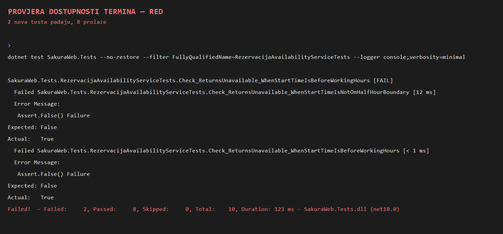
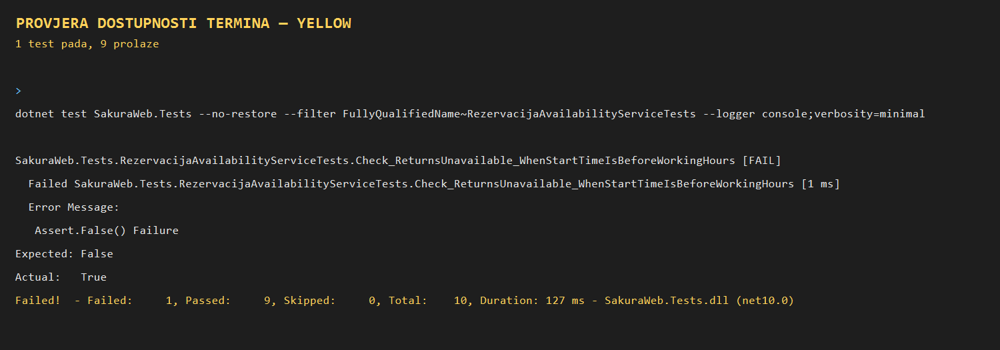
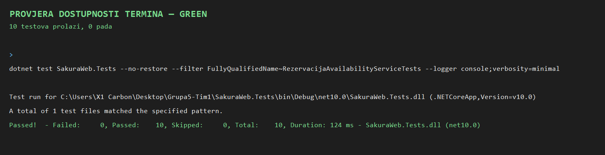

# TDD izvještaj — provjera dostupnosti termina

## Obuhvat

Ovaj izvještaj pokriva samo drugu dodijeljenu stavku: proširenje **postojeće provjere dostupnosti termina**. Ne uvodi se treća funkcionalnost i ne mijenja se pretraga proizvoda. Osnovni servis je već postojao; ovaj rad dopunjava njegove testove i pravila termina.

## Specifikacija i testni slučajevi

Provjera dostupnosti treba primijeniti sljedeća pravila:

| Scenario | Očekivano ponašanje | Test |
|---|---|---|
| Postojeća rezervacija je otkazana | Novi termin ostaje dostupan. | `Check_AllowsSlot_WhenExistingReservationIsCancelled` |
| Postojeća rezervacija je na drugi datum | Ne blokira izabrani datum. | `Check_AllowsSlot_WhenExistingReservationIsOnAnotherDate` |
| Postojeća rezervacija pripada drugom frizeru | Isti termin je dostupan drugom frizeru. | `Check_AllowsSameTime_WhenReservationBelongsToAnotherFrizer` |
| Nova usluga pokriva više polusatnih termina i preklapa se s kasnijim zauzetim intervalom | Termin se odbija. | `Check_ReturnsUnavailable_WhenLongerServiceOverlapsLaterSlot` |
| Početak je tačno u 16:30, trajanje 30 minuta | Termin je prihvatljiv kao posljednji početak u rasporedu. | `Check_AllowsSlot_WhenServiceStartsAtLatestAllowedTime` |
| Početak je poslije 16:30 | Termin se odbija kao van radnog vremena. | `Check_ReturnsUnavailable_WhenServiceStartsAfterLatestAllowedTime` |
| Početak nije na puni sat ili pola sata | Termin se odbija sa validacijskom porukom. | `Check_ReturnsUnavailable_WhenStartTimeIsNotOnHalfHourBoundary` |
| Početak je prije radnog vremena (09:00) | Termin se odbija kao van radnog vremena. | `Check_ReturnsUnavailable_WhenStartTimeIsBeforeWorkingHours` |

Testovi su u `SakuraWeb.Tests/RezervacijaAvailabilityServiceTests.cs`; implementacija je u `SakuraWeb/Services/RezervacijaAvailabilityService.cs`.

## TDD faze

Svaka faza ima jedan zaseban commit. **YELLOW** je namjerni međukorak: dio novih testova prolazi, ali bar jedan još pada. Slike su sačuvani isječci stvarnog izlaza `dotnet test` za tu fazu.

### RED — testovi prije implementacije

Dodani su regresijski testovi za otkazanu rezervaciju, drugi datum, višeslotno preklapanje i granice rasporeda. Ta pravila su već bila podržana postojećim servisom. Dva nova testa koja otkrivaju nedostajuće provjere početnog vremena — poravnanje na polusatne intervale i početak prije 09:00 — padaju. Ukupno: **2 pada, 8 prolaza**.



Commit: `d406b89` — `test (RED): expand reservation availability edge cases`

### YELLOW — djelimična implementacija

Servis sada odbacuje početke koji nisu na puni sat ili pola sata. Test za neporavnati termin prolazi; provjera početka prije 09:00 još nedostaje. Ukupno: **1 pad, 9 prolaza**.



Commit: `efc2bcc` — `feat (YELLOW): reject off-grid reservation start times`

### GREEN — svi testovi prolaze

Dodana je donja granica rasporeda od 09:00, uz postojeću završnu granicu za zadnji dozvoljeni početak termina. Svi testovi provjere dostupnosti prolaze. Ukupno: **10 prolaza, 0 padova**.



Commit: `7f803d9` — `feat (GREEN): enforce reservation working hours`

## Završna provjera

Pokrenuta komanda nakon GREEN faze:

```powershell
dotnet test SakuraWeb.Tests\SakuraWeb.Tests.csproj --no-restore --filter "FullyQualifiedName~RezervacijaAvailabilityServiceTests" --logger "console;verbosity=minimal"
```

Rezultat: **10 prošlo, 0 palo**. Build prikazuje ranija upozorenja projekta, ali ciljani testovi su uspješno izvršeni.

## Napomena o raspodjeli

Ovo je samo dio člana 2 — provjera dostupnosti termina. Ne dokumentuje niti pripisuje rad na pretrazi proizvoda ili drugim članovima tima.
